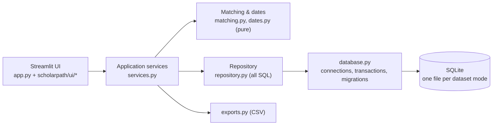
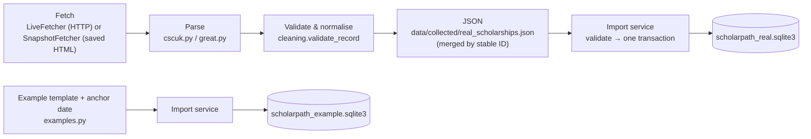
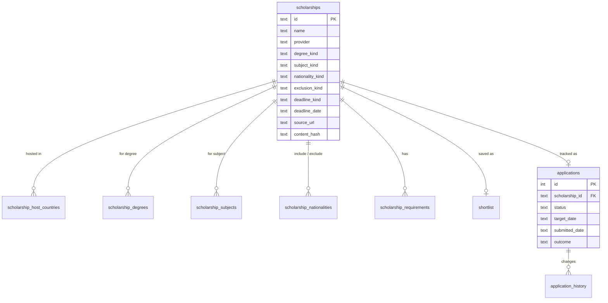

# Architecture

## Layers

| Module | Responsibility | Not allowed |
|---|---|---|
| `ui/*.py` | Navigation, forms, display, temporary selections in `st.session_state` | SQL, HTTP, reading JSON files, storing business data in session state |
| `services.py` | Operations used by UI and CLI; validation; transaction boundaries | Streamlit calls |
| `repository.py` | Parameterized SQL only | Business rules |
| `database.py` | Connections, foreign keys, busy timeout, transactions, migrations | Data-specific logic |
| `matching.py`, `dates.py` | Pure rules with injected `today` | I/O |
| `collectors/*` | Fetching (base.py) and source-specific parsing | Writing to the database |

## Collection and import pipeline

Collection is only ever triggered by the CLI (`python -m scholarpath collect ...`).
The Streamlit app never fetches web pages.

## Database

Also: `meta` (dataset mode, example anchor date, last import), `import_runs`, `schema_migrations`.

Key decisions:

- **Normalized multivalued fields** (countries, degrees, subjects, nationalities) so filters are
  indexed `EXISTS` sub-queries, not string matching.
- **`*_kind` columns** keep "unrestricted", "list" and "unknown" distinct.
- **`ON DELETE RESTRICT`** from `shortlist` and `applications` to `scholarships`: a scholarship
  that the user saved or tracked cannot be deleted. Child rows of a scholarship use `CASCADE`
  because only the scholarship owns them.
- **CHECK constraints** enforce "dated ⇔ has date" and "score ⇔ scale" at the database level too.
- **Separate database per mode** (`config.db_path(mode)`); a `meta.dataset_mode` row stops a file
  being opened in the wrong mode. Each mode only accepts records with the matching `dataset_origin`.

## Transactions and imports

- `database.connect()` opens a connection per operation, enables `PRAGMA foreign_keys`, sets a busy
  timeout and always closes it. There is no shared global connection.
- `database.transaction()` runs `BEGIN IMMEDIATE` … `COMMIT`, or `ROLLBACK` on any exception.
  A lock that outlasts the timeout raises `DatabaseBusyError` with a readable message.
- **Import policy:** every record is validated before anything is written. Invalid records are
  rejected individually with reasons. All valid records are then written in **one** transaction;
  any database error rolls back the whole batch. Zero valid records → refused, nothing changes.
- Records are upserted by stable ID: insert, `UPDATE` in place (if the content hash changed) or
  "unchanged". Rows are never deleted and re-inserted, so saved items and tracker entries keep
  pointing at them. Each run is logged in `import_runs`.

## Migrations

`database.MIGRATIONS` is an ordered list `(version, description, sql)`. `migrate()` applies each
pending version in its own transaction, records it in `schema_migrations` and sets
`PRAGMA user_version`. Migrations only add structure (v2 added `application_history`, with a
backfill row per existing application, and `import_runs`). A test builds a v1 database with user
data, migrates it and checks that nothing was lost.

## Caching (Streamlit)

Read-heavy calls (search, overview, filter options) use `st.cache_data`, keyed by the
**database path** and today's date, so the two modes can never share cached results. After every
successful write the UI calls `st.cache_data.clear()`. Switching the dataset clears temporary
selections (selected scholarship, match results, filters).

## Matching

`matching.evaluate(profile, record)` runs fixed rules: nationality, exclusions, degree, subject,
academic score (only if the record has a numeric threshold) and one "manual review" rule per
unresolved requirement. Each returns *student value, recorded requirement, status, reason*.
Overall: any failed → "Does not match recorded requirements"; else any unknown →
"Needs manual verification"; else "Matches recorded requirements". Preferred destination is
applied as a host-country filter before matching, and deadline status is shown separately.

## Dates

`Clock` provides "today" in `Asia/Kolkata` (configurable with `SCHOLARPATH_TIMEZONE`;
`SCHOLARPATH_TODAY` pins it for demos/tests). Status is computed at read time in SQL for
filters/sorting (`repository.STATUS_SQL`) and in Python (`dates.deadline_status`) for display;
tests check both agree on the boundaries.
